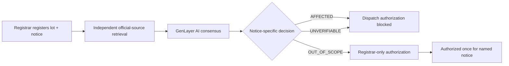

# RECALLBOUND

### Consensus-verified product recall scope decisions on GenLayer

**RECALLBOUND V1** is a standalone GenLayer Intelligent Contract primitive that checks whether an explicitly identified product lot falls within **one specific official recall notice**. It combines external-source retrieval, independent AI consensus, immutable inventory metadata, and a consequential one-time notice-scoped authorization gate.

> **Safety boundary:** `OUT_OF_SCOPE` applies only to the **specific chosen notice**; it does not establish overall product safety, that an item exists, that an owner has title, or that shipment is lawful. This is an unaudited development demonstration, **not** a product safety clearance or live logistics platform.

**Status (28 October 2026):** Deployed on GenLayer Studionet (61999). Live `register_lot` and `assess_lot` completed successfully; `RB-AFFECTED-001` returned **AFFECTED** with Equivalence Principle output **AFFECTED**. A subsequent finalized `get_case` readback confirmed `decision: AFFECTED` and dispatch authorization `false`. A signed attempt to authorize dispatch for the affected lot also **FINALIZED with an expected GenVM ERROR/rollback** (`Not confirmed outside this specific notice`); post-rollback state readback is still pending. The explicit-exclusion and authorization scenarios remain pending. [Inspect the first signed transaction evidence](docs/LIVE_EVIDENCE.md).

[Contract source](contracts/recallbound.py) · [Steward guide](REVIEWER.md) · [Live evidence](docs/LIVE_EVIDENCE.md) · [Studio test plan](docs/ACCEPTANCE.md) · [Security](SECURITY.md)

---

## Why an Intelligent Contract?

Recall notices often contain **model exceptions, serial ranges, affected regions and ambiguous descriptions**. Deterministic rules can check addresses and request state, but cannot fully interpret those natural-language scope boundaries.

1. A registrar binds a synthetic inventory record to an immutable **official notice URL and notice reference**.
2. The GenLayer leader fetches the notice and assesses the exact model, serial/lot and region.
3. Validators **independently fetch and assess** the same URL; consensus compares the consequential decision field.
4. A decision is stored as `AFFECTED`, `OUT_OF_SCOPE` or `UNVERIFIABLE`.
5. Only an explicitly confirmed `OUT_OF_SCOPE` case can receive a **one-time, registrar-only authorization limited to the selected notice**. An affected or unverified case remains blocked.



## Grounded demonstration — actual U.S. CPSC notice

Unlike a synthetic recall generated for a demo, this test uses a **real CPSC publication**.

**[CPSC recall 25-395](<https://www.cpsc.gov/Recalls/2025/Curtis-International-Recalls-Frigidaire-brand-Minifridges-Due-to-Fire-and-Burn-Hazards-More-Than-700-000-Reported-in-Property-Damage>)** (July 24, 2025) names Frigidaire-branded minifridges and lists model/serial ranges. In particular, `EFMIS129` serials `A2001` through `A2308` are included, while the publication **explicitly excludes variants `EFMIS129-B` and `EFMIS129-C`**. The source defines scope for a published recall; it does not certify any excluded unit as safe.

We use **fictional inventory records** with a serial in the stated range for both cases:

| Demo case | Model | Serial / lot | Expected decision | Gate behavior |
|---|---|---|---|---|
| `RB-AFFECTED-001` | `EFMIS129` | `A2200` | **AFFECTED** | Authorization blocked |
| `RB-EXCLUDED-002` | `EFMIS129-B` | `A2200` | **OUT_OF_SCOPE** | One-time, registrar-only authorization can be recorded |

Both are **expected** decisions based on public source text, **not yet successful on-chain claims**. Live validator outcomes can differ or fail closed, and must be verified in Studio.

Exact fields, copyable values, negative tests and evidence requirements are in [docs/ACCEPTANCE.md](docs/ACCEPTANCE.md).

## Contract API

| Method | Function |
|---|---|
| `register_lot(lot_id, model, batch, region, official_notice_url, notice_ref)` | Registrar records fixed inventory attributes and one allowlisted official notice |
| `assess_lot(lot_id)` | Real web+LLM operation with independent validator adjudication |
| `get_case(lot_id)` | Read immutable source, registered lot, decision, authorization |
| `authorize_dispatch_for_notice(lot_id)` | Registrar-only; `OUT_OF_SCOPE` and not previously authorized |

**Source allowlist:** HTTPS CPSC Recalls and FDA recall pages. The contract blocks several URL spoofing patterns but cannot cryptographically attest to HTTPS content or guarantee redirect targets; web access and source drift require additional hardening before any operational use.

## Trust and safety model

- Source URL, reference and item metadata are immutable after registration.
- Non-owner lot registration and dispatch authorization are rejected.
- Fail-closed: missing/ambiguous/short/inaccessible source or malformed model output ⇒ `UNVERIFIABLE`; this cannot pass the gate.
- Validators reevaluate the **source-backed decision**, rather than checking whether the leader wrote a plausible answer.
- Prompt treats web content as untrusted text and requires an **affirmative exclusion** for `OUT_OF_SCOPE`, including exact model variants; a missing row is never evidence of safety.
- A result is **notice-specific**; the contract cannot evaluate other recalls, physical identity, real inventory custody or future changes to the notice. Decisions are not automatically refreshed.

## Tests and evidence

```bash
python -m unittest discover -s tests -v
```

Existing state-machine shim tests and 5 additional tests using a **controlled CPSC-notice fixture** cover ownership, replay, missing sources, malformed output, explicit exclusion paths and prompt boundaries. LLM verdicts in the fixture are **mocked**; this is not evidence of live GenVM consensus. The submitted repository must include an independent real Studio run with signed transaction and explorer details before it is ready for Portal review.

[Security/disclosure](SECURITY.md) · [MIT License](LICENSE)
